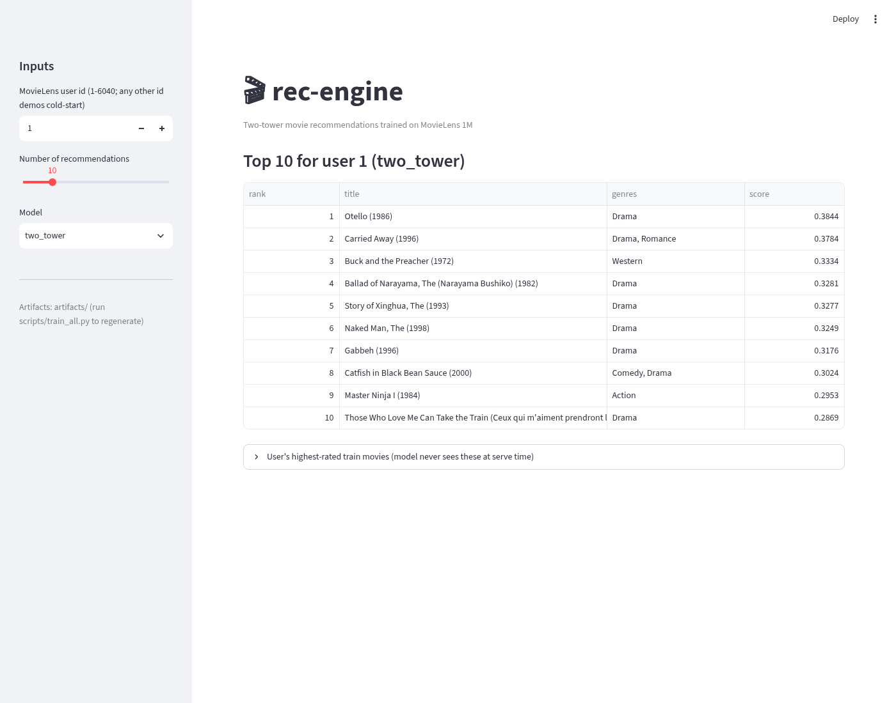
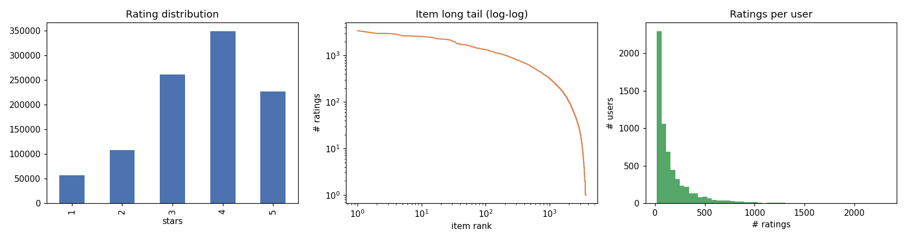
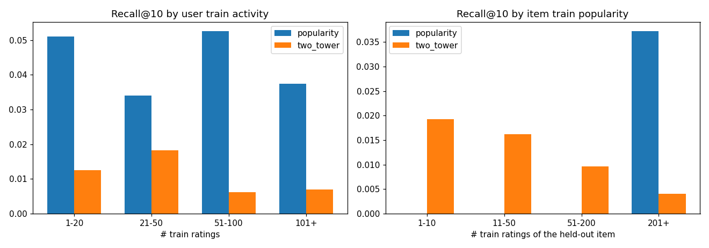

# rec-engine

An end-to-end movie recommendation system built from scratch on **MovieLens 1M**:
popularity baseline -> matrix factorization -> two-tower neural retrieval, with a
chronological evaluation harness, cold-start analysis, FAISS serving and a Streamlit demo.



## Problem

Given a user's rating history, rank the ~3.7k-movie catalog so the movies they will
rate next land near the top. Evaluated the way a production system is used: **train on
the past, predict the future** (global chronological split, not a random shuffle).

## Dataset

MovieLens 1M: 1,000,209 ratings from 6,040 users on 3,706 movies (density 4.5%).
Split at the 80th percentile of the timeline: 800,164 train events / 200,045 test events.
95,593 test events (48%) involve a user or item with no train history at all - they are
excluded from the main metrics and studied separately in the cold-start analysis.



## Results (full-catalog ranking, 1,143 evaluated users, 104,452 held-out events)

| Model                  | Recall@10 | NDCG@10 | Recall@50 | NDCG@50 |
|------------------------|-----------|---------|-----------|---------|
| Popularity (smoothed)  | **0.0411** | **0.2650** | **0.1382** | **0.2289** |
| Matrix factorization   | 0.0333    | 0.1845  | 0.1281    | 0.1882  |
| Two-tower (in-batch)   | 0.0086    | 0.0534  | 0.0488    | 0.0667  |

All numbers produced by `scripts/train_all.py` on this repo's exact code; runs are
logged to MLflow (sqlite backend) and `results/runs.jsonl`.

**How to read these numbers.** Each evaluated user has ~91 held-out events on average,
so Recall@10 denominators are large (NDCG@10 exceeding Recall@10 is expected here, not a
bug). The chronological tail of MovieLens is dominated by blockbusters, which makes the
popularity baseline genuinely hard to beat on this split: MF comes close on Recall@50 but
does not pass it, and the lightly-trained two-tower lags on the head metric.

**Where the two-tower wins: the long tail.** Popularity gets *every one* of its hits on
items with 201+ train ratings and literally 0.0 recall on anything less popular. The
two-tower retrieves items with as few as 1-10 train ratings (Recall@10 0.0192 in that
bucket), which is exactly what a retrieval model is for.



## Architecture

```
ratings.dat ──> chronological split ──> popularity baseline
                                     ├─> MF (biased, BCE + sampled negatives)
                                     └─> two-tower (user id-emb; item id-emb + genre projection;
                                                    in-batch sampled softmax, learned temperature)
                                                   │
        evaluation (Recall@K / NDCG@K, train-masked, full catalog)
                                                   │
        item embeddings ──> FAISS IndexFlatIP ──> FastAPI /recommend ──> Streamlit demo
```

- **MF**: user/item embeddings + biases, BCE over uniformly sampled negatives
  (dim 64, 10 epochs, 4 negatives/positive, lr 0.02).
- **Two-tower**: normalized 64-d towers; the item tower adds a linear projection of the
  multi-hot genre vector, so a brand-new item with known genres gets a sensible vector.
  Trained with in-batch sampled softmax + learnable temperature (16 epochs, batch 2048).
- **Serving**: user vector -> FAISS inner-product search -> train-history masking ->
  titles. Unknown users fall back to popularity (response says `"fallback": "popularity"`).
- **Tracking**: every run logs params + metrics to MLflow (`mlflow.db`) and
  `results/runs.jsonl`.

## Serving latency (measured, local uvicorn, single worker, CPU)

300 requests to `GET /recommend?k=10`: **p50 3.07 ms, p95 3.26 ms**.

## What doesn't work yet (honest list)

- Popularity still wins the headline metrics on this split. The two-tower needs
  sampled-softmax with a proper negative sampler (or full softmax over the 3.7k catalog),
  more epochs, and sequence features to compete on Recall@10.
- No retraining pipeline or online features; artifacts are a one-shot snapshot.
- 48% of test events are cold users/items; the only fallback today is popularity.
  The item tower's genre projection is the hook for a real cold-item path.
- The Dockerfile was written and statically reviewed but **not built** in the authoring
  environment (no Docker daemon there); the app code paths it runs are tested locally.
- The demo deploys nowhere yet: run Streamlit locally, or push to Hugging Face Spaces
  (see below).

## Run it

```bash
python -m venv .venv && source .venv/bin/activate
pip install torch --index-url https://download.pytorch.org/whl/cpu
pip install -r requirements.txt

python src/data.py 2>/dev/null || python -c "from src import data; data.download()"  # fetch MovieLens 1M
python scripts/run_eda.py            # dataset stats + figures
python scripts/train_all.py prepare  # split (stages can run separately)
python scripts/train_all.py popularity
python scripts/train_all.py mf
python scripts/train_all.py two_tower
python scripts/train_all.py finalize # results/metrics.json
python scripts/cold_start.py         # results/cold_start.json + figure
python scripts/build_index.py        # FAISS index

uvicorn serve.app:app                # API on :8000
python scripts/measure_latency.py    # p50/p95 into results/latency.json
streamlit run app/streamlit_app.py   # demo on :8501
pytest tests/                        # metric, split and API tests
```

Pre-trained artifacts (embeddings, FAISS index, popularity scores) are committed under
`artifacts/`, so the API and demo work straight after `pip install` + downloading the
dataset.

## Docker

```bash
docker build -t rec-engine .
docker run -p 8000:8000 rec-engine
```

## Deploy the demo (Hugging Face Spaces)

1. Create a Space (Streamlit SDK) and push this repo.
2. Add a `packages.txt` if the runner needs system libs (usually not).
3. The committed artifacts make the app start without training.

## Repo layout

```
src/            data loading, chronological split, metrics, tracking, models
scripts/        EDA, staged training, cold-start analysis, FAISS build, latency probe
serve/app.py    FastAPI /recommend + /health
app/            Streamlit demo
tests/          pytest: metrics correctness, split integrity, API contract
results/        metrics.json, cold_start.json, latency.json, runs.jsonl, figures
artifacts/      trained embeddings, FAISS index, popularity scores (committed)
docs/           README images
```
